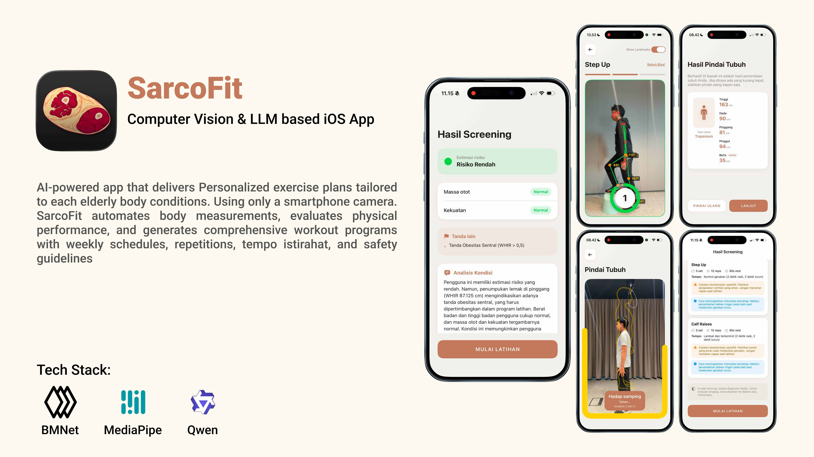

# Sarc-o-meter

Sarc-o-meter is an on-device iOS application for sarcopenia screening, anthropometric body estimation, and real-time functional exercise assessment. It combines Apple Core ML, Vision framework, MediaPipe pose tracking, and clinical evaluation rules (AWGS 2019) to deliver private, real-time assessment entirely on-device.



TestFlight Beta: https://testflight.apple.com/join/87X3gjtV

---

## Key Features

- Clinical Sarcopenia Screening: Automated evaluation using Asian Working Group for Sarcopenia (AWGS 2019) criteria, SARC-F questionnaire, contraindications, and red-flag screening.
- AI Body Measurement (BMNet): Two-photo capture (front and side) segmented with Apple Vision framework and processed via Core ML (`bmnet.mlpackage`) to estimate 14 body measurements, including calf circumference and waist-to-height ratio (WHtR).
- Real-Time Functional Exercise Assessment: Camera-based movement analysis via MediaPipe Pose Landmarker (`pose_landmarker.task`) with automated rep counting, angle validation, and auditory cues for:
  - 5-Times Sit-to-Stand (chair stand test)
  - Step-Up test
  - Calf Raise test
- On-Device Recommendations & RAG: Local rule engine coupled with an on-device knowledge retrieval system (RAG) to generate personalized workout recommendations without sending user health data to external servers.
- Longitudinal Progress Tracker: Local persistence of screening records, body measurements, and exercise performance history over time.

---

## Three-Tier System Architecture

### Tier 1: Body Pose Estimation & Real-Time Motion Tracking
- Captures body landmarks in real-time via camera using Apple Vision and MediaPipe Pose Landmarker (`pose_landmarker.task`).
- Generates precise silhouettes for automated body measurement during static capture.
- Tracks joint angles and validates movement form with automated repetition counting during functional strength tests (Sit-to-Stand, Step-Up, Calf Raise).

### Tier 2: Automated Body Measurements & Clinical Integration
- Processes silhouette masks through the Core ML `BMNet` model to compute 14 anthropometric measurements.
- Evaluates key biomarkers (calf circumference for muscle mass, waist circumference/WHtR for central obesity).
- Integrates inputs into a deterministic on-device AWGS 2019 Rule Engine to classify risk (Normal, Limited, Abnormal).

### Tier 3: On-Device LLM & RAG Implementation
- Operates locally on Apple Silicon / Metal GPU via MLX Swift (`mlx-community/Qwen2.5-3B-Instruct-4bit`).
- Retrieves verified clinical guidance and exercise protocols through on-device RAG (`knowledge_chunks.json`).
- Synthesizes personalized, plain-language health explanations and tailored physical therapy plans without external network calls.

---

## Team Contributions

- Surya Ramadhani: Body Pose Estimation & Tracking (Vision/Core ML segmentation, static silhouette generation, real-time joint angle calculation, and automated exercise rep counters).
- Kemal Dwi Heldy Muhammad: Automated Body Measurements & Integration (BMNet model pipeline, 14-metric extraction, and AWGS 2019 deterministic rule engine implementation).
- Vira Fitriyani: LLM & RAG Implementation (On-device LLM integration via MLX Swift, local RAG architecture, knowledge base curation, and personalized exercise plan generation).

---

## Repository Structure

| Directory / File | Description |
|---|---|
| `sarc-o-meter/App/` | Application entry (`sarc_o_meterApp.swift`) and main navigation router (`ContentView.swift`) |
| `sarc-o-meter/Core/Scan/` | BMNet Core ML predictor, pose-guided photo capture, and body measurement screens |
| `sarc-o-meter/Core/Model/` | Data models: `User`, `BodyMeasurements`, `ScreeningRecord`, and `Gender` |
| `sarc-o-meter/Core/Support/` | Persistence (`UserStore`), logging (`DebugLog`), sound manager, and on-device LLM bridge |
| `sarc-o-meter/Features/Screening/` | AWGS 2019 rule engine, clinical questionnaire, on-device RAG, and diagnosis views |
| `sarc-o-meter/Features/Exercise/` | MediaPipe pose landmarker service, rep counters, smoothing filter, and workout UI |
| `sarc-o-meter/Features/Tracker/` | Measurement history and progress tracking dashboard |
| `sarc-o-meter/bmnet.mlpackage` | Trained Core ML model for body measurement estimation |
| `README_iOS.md` | Original technical note on the BMNet Core ML pipeline |

---

## Requirements

- iOS 17.0 or later
- Xcode 15.0 or later
- CocoaPods (for dependencies such as MediaPipe)
- Physical iOS device with camera (simulator does not support camera capture or real-time pose detection)

---

## Getting Started

### 1. Installation

Clone the repository and install CocoaPods dependencies:

```bash
git clone https://github.com/SarcopeniaApp/sarc-o-meter.git
cd sarc-o-meter-main
pod install
```

Open `sarc-o-meter.xcworkspace` in Xcode (always open the workspace, not the `.xcodeproj`).

### 2. Permissions (Info.plist)

Ensure the following privacy descriptions are configured:

| Key | Value | Purpose |
|---|---|---|
| `NSCameraUsageDescription` | "Take body photos for measurement and exercise tracking." | Camera access for scan and rep counting |
| `NSPhotoLibraryUsageDescription` | "Pick body photos for measurement." | Photo picker access |
| `NSLocalNetworkUsageDescription` | "Send debug logs to the Mac." | Developer live-streaming to Mac debug server |
| `NSAppTransportSecurity` -> `NSAllowsLocalNetworking` | `YES` | Allow local HTTP streaming to the debug server |
| `ITSAppUsesNonExemptEncryption` | `NO` | Export compliance declaration for App Store / TestFlight |

### 3. Build & Run

1. Select a registered development team in Signing & Capabilities.
2. Select your physical iOS device as the run destination.
3. Build and run (Cmd + R).

To run the standalone rep-counter testing harness directly without going through the entire screening flow, launch the app with the `--exercise-lab` launch argument (or use the ExerciseLab scheme).

---

## Development & Debugging Tools

### Mac Debug Server (Optional)

The app can stream intermediate segmentation masks, concatenated silhouettes, and measurement outputs to your Mac in real time over local Wi-Fi:

1. On your Mac (on the same Wi-Fi network as the device), run:
   ```bash
   python3 tools/debug_server.py
   ```
2. Enter the displayed URL (e.g., `http://10.0.0.12:8000`) into the **Debug server** field in the app settings.
3. Every measurement run will output stages into `tools/debug_runs/<timestamp>/`:
   - `00_front.png`, `00_side.png` (input photos)
   - `01_seg_front.png`, `01_seg_side.png` (Vision person masks)
   - `03_silhouette.png` (concatenated silhouette seen by the Core ML model)
   - `log.txt` (measurements, inference latency, warnings)

If the debug server field is left empty, the app logs all diagnostic details to the Xcode console via `os_log` (subsystem: `com.sarcxey.bmnet`).

---

## Capture Guidelines for Accurate Results

- Stand in an A-pose (feet shoulder-width apart, arms slightly away from the torso).
- Ensure head-to-toe framing in both the front view and 90-degree side view.
- Wear form-fitting clothing and maintain good contrast against the background to ensure clean Vision segmentation.
- While calf circumference is estimated by the model for convenience, clinical sarcopenia confirmation recommends manual verification using a standard non-elastic tape measure.

---

## Disclaimer

Sarc-o-meter is designed for preliminary functional screening, educational, and fitness monitoring purposes. It does not replace professional medical diagnosis, laboratory muscle mass assessment (such as DXA or BIA), or formal clinical evaluation.
